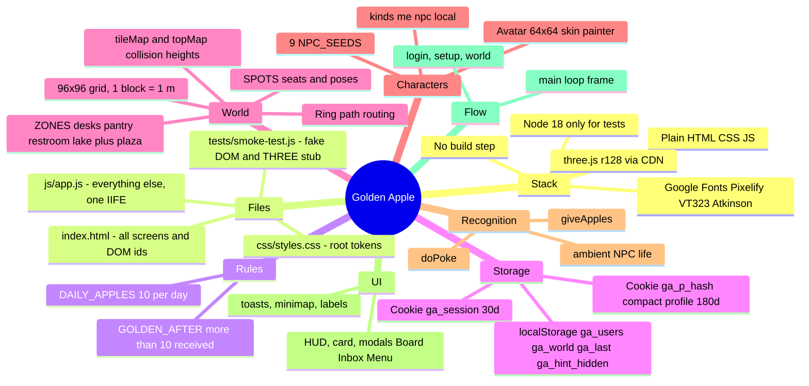

# Golden Apple — Codebase Mind Map (for Claude)

Read this map before you open any files. Line numbers are approximate (map written 2026-10-17, app.js = 1320 lines). If they have drifted, run `grep -n "^/\* ===\|^   [A-Z]" js/app.js` to re-locate sections.

## Mind map



## Files

| File | Lines | What it holds |
|---|---|---|
| `index.html` | 200 | Every screen as static markup: `#screen-login`, `#screen-setup`, `#hud` (with `#card`, `#touch`, `#minimap`, `#feed`), `#modal`, `#toasts`, `#bootErr`. It loads three.js r128 from cdnjs, then `js/app.js`. |
| `css/styles.css` | 262 | `:root` tokens (bark, cream, gold, apple, the `--st-*` status colours and the `--f-display/body/num` fonts), then components (`.panel .btn .tag .bubble .chip .bar .pips`) and per-screen styles. Pixel look: hard inset box-shadows, `image-rendering:pixelated`. |
| `js/app.js` | 1320 | All logic in one `(function(){'use strict'; ... })();` IIFE. Lines are dense one-liners: read by range, not whole. |
| `tests/smoke-test.js` | 200 | `eval`s app.js with a fake DOM, cookie jar, localStorage and a math-faithful THREE stub. It injects `window.__ga={...}` by regex-replacing the final `})();`, so **keep `})();` as the last line of app.js**. |
| `package.json` | — | `npm start` runs `npx serve -l 5500 .`; `npm test` runs `node tests/smoke-test.js`. No dependencies. |
| `README.md` | — | User-facing docs, "Good first changes" table, storage notes, known limits. |
| `.vscode/` | — | Live Server recommendation, port 5500, 2-space tabs, LF line endings. |

There is no git repo, no bundler, no framework and no server.

## js/app.js section index (line ≈)

| Line | Section | Key names |
|---|---|---|
| 1 | TOC comment | — |
| 29 | Boot guard | if `!window.THREE`, shows `#bootErr` and returns |
| 34 | **Rules** | `DAILY_APPLES=10`, `GOLDEN_AFTER=10`, `isGolden(n)` (n > 10) |
| 38 | helpers | `$`, `clamp`, `rand`, `pick`, `mulberry32` (seeded RNG), `hashStr`, `todayKey`, `esc` (HTML escape, use it for all innerHTML), `timeAgo`, `shade`, `angleLerp`, `reduceMotion`, `coarse` (touch), `isTyping` |
| 57 | Pixel icons | `APPLE_MAP`, `pixelIcon`, `ICON_APPLE/GOLD/EMPTY/POKE` (data URLs) |
| 68 | **Storage** | `Store` (localStorage with in-memory fallback, JSON), `Cookies` (tries the `Partitioned; SameSite=None; Secure` variants in turn, verifies by read-back), `b64e/b64d` |
| 86 | Avatar options | `AV` (palettes and styles), `AV_KEYS` order (skin, hairStyle, hair, eyes, top, topColor, pants, shoes, acc), `AV_STYLE` (stepper rather than swatch), `randomAvatar`, `avatarToArr/arrToAvatar` |
| 107 | **Data model** | `USERS` (from `ga_users`), `findUser` (localStorage first, then rebuild from cookie), `putUser`, `writeProfileCookie` (compact keys e,n,r,t,s,a,rc,c), `budgetLeft`, `spendBudget` (`given={d:todayKey,n}`) |
| 126 | Content tables | `NPC_SEEDS` (9: priya arjun meera daniel sofia kenji fatima rahul lena), `REASONS`, `POKES`, `REPLIES`, `THANKS`, `NOTES`, `STATUS` |
| 144 | World seed | `seedWorld()` gives `WORLD={v:1,npc:{id:{received,given,recent,goldenAt}},feed:[]}`; `WORLD` is stored under `ga_world` |
| 162 | **state** | `{mode:'login'|'setup'|'world', me, player, chars:Map, selected, pokeMsg, cookieOK, modal, setup, hintHidden}` |
| 167 | Three.js core | `renderer`, `scene`, `camera`, fog, sky, lights, `sun` shadows (disabled when `coarse`), `UNIT_BOX` |
| 188 | Textures | `canvasTex`, `noiseTex`, `waterTex`, `glowTex`, 16px **atlas** `TILE_NAMES` (16 tiles), `blockGeo`, `BLOCK_TYPES` |
| 239 | **World layout** | `N=96, HALF=48`, `tileMap`, `topMap` (collision height per cell: 0 ground, -1 water, 2 walls, 99 trunks), `idx`, `cellTop`, `solidRect`, `raiseTop/setTop` |
| 252 | **ZONES** | desks (N, z -38..-17), pantry (E, x 18..33), restroom (W, x -31..-20), lake (S, z≈18..44). Each has `inside`, `gate` and `spoke` (index into `RING`, 8 points r=3.4 around the plaza) |
| 265 | Spots | `SPOTS[]`, `addSpot({zone,x,z,y,face,pose,approach,via,desk})`; poses are sit, stand, coffee, wash, stall, look |
| 272 | `buildLayout()` | plaza disc, paths, zone floors and walls (glass for desks and pantry), lake ellipse `lakeE`, dock, hedge border |
| 304 | `tree`, `bench`, `plant`, `sign` | furniture helpers; `fbox(...)` queues boxes into `FURN.noise/glow/glass` |
| 354 | `buildFurniture()` | 6 desk pods x 4 = 24 desk seats (`desk:true`), pantry tables A/B with `pantryVia`, restroom sinks and stalls, plaza benches, **Orchard Board** (`boardMesh`, `BOARD_POS`), lake benches and viewpoints, signs |
| 456 | `buildTrees()` | big plaza apple tree, so `TREE_APPLE_SLOTS`; random small trees and flowers |
| 478 | `finalizeMeshes()` | turns the `BLOCKS` and `FURN` queues into InstancedMeshes |
| 500 | Tree apples / board | `treeApples` InstancedMesh(40), `updateTreeApples`, `drawBoard()` (canvas texture), `clouds`, `ducks` |
| 541 | **Avatars** | `PX=1.8/32`, `PARTS` UV nets (Minecraft-style 64x64 skin), `paintSkin(av)` returns a canvas, `buildAvatar(av)` returns `{root,model,hips,legR/L,armR/L,headPivot,canvas,disposables}`, `headIcon`, `makeApple` |
| 636 | **class Character** | `{id, kind:'me'|'npc'|'local', data, root, anim{pose,speed,run,air,celebrate,startle,poke,give,wave}, crown, tag, bubble}` plus methods `setAvatar`, `golden` (getter), `refresh` (nameplate), `say`, `hop`, `faceTo`, `update(dt)` (procedural limb animation), `dispose` |
| 702 | **NPC brains** | `NPC_WEIGHTS` (desks .5, pantry .22, lake .18, restroom .1), `NPC_DUR`, `npcs[]`, `routeFromTo(a,b)` (reverse a.via, then inside, gate, ring arc, gate, inside, b.via, spot), `freeSpot`, `placeAt`, `npcPickNext` (stall then wash), `npcArrive`, `npcThink` |
| 749 | People registry | `allPeople()`, `spawnNPCs()` (NPC `data` uses getters/setters that proxy `WORLD.npc[id]`; each has a reserved `home` desk) |
| 769 | Effects | particles `spawnP/burst` (PMAX 520), `fly()` projectiles, `ringWave`, `selRing`, `handPos/headPos` |
| 802 | **Player / input** | `cam{yaw,pitch,dist,target}`, `keys` Set, `joy`, `SPAWN {0, 9.5}`, `updatePlayer` (WASD relative to camera, Shift runs 5.6 vs walk 3.0, water slows by .55, jump vy 7, gravity 22), `blocked`, `supportY`, `nearestSeat`, `sitOn`, `standUp`, `tryInteract` (E key: stand, read board, or sit) |
| 838 | Keyboard | Esc closes modal or card; Space jumps; E interacts |
| 851 | Pointer | drag to orbit, wheel to zoom 4..24, `handlePick` raycast (single click opens card, double click within 400 ms pokes, clicking the board opens it) |
| 874 | Touch | joystick `#joy`, `#tUse/#tRun/#tJump`; `resize`, `applyViewOffset` (shifts the view when the card is open), `updateCamera` |
| 898 | Labels | `placeEl`, `updateLabels` (projects nameplates and bubbles to screen) |
| 918 | Minimap | `mmBase` (prerendered), `drawMinimap`, `zoneAt(x,z)` |
| 943 | **Recognition logic** | `persistData(ch)` (npc saves WORLD; me/local save USERS, plus the cookie for me), `pushFeed` (max 40), `pushInbox` (max 50, not for NPCs), **`giveApples(from,to,count,reason,note)`** returns `false` or `{became}`, `animateGift`, `growCrown`, **`doPoke(from,to,msg)`** (2.5 s cooldown per pair), `npcReact`, `ambient` and `updateAmbient` (NPC-to-NPC gifts every 60–110 s, gifts to the player 100–180 s, pokes to the player 140–240 s) |
| 1032 | UI rendering | `toast(html,kind,ms,icon)` (max 3), `statusChip`, `goalText`, `pipsHtml`, `renderMe` (HUD), `renderZone`, `renderFeed` |
| 1056 | Coworker card | `giveState{open,reason,count,note}`, `openCard`, `closeCard`, `renderCard` (give-apples form and poke) |
| 1112 | Modals | `showModal(name,html)`, `closeModal`, `openBoard` (Golden Apples list and recent feed), `openInbox` (marks items read, Poke back), `openMenu(confirmDelete)` (storage status, logout, delete) |
| 1154 | Hint | `scheduleHintHide` |
| 1163 | **Login / setup / session** | `EMAIL_RE`, `returningUser` (`ga_session` cookie or `ga_last`), `showLogin`, login submit (lowercases and trims; an existing email logs straight in), `startSession`, `openSetup('create'|'edit',email)`, `buildAvControls`, setup submit (name of 2+ chars) |
| 1233 | Avatar preview | a second WebGLRenderer `pv`, `ensurePreview`, `updatePreview`, `renderPreview` |
| 1256 | Enter / leave | `enterWorld(rec)` (creates the `me` Character and spawns the other `USERS` as `local` "Away" characters at free desks; toasts unread inbox items), `resumeWorld`, `leaveWorld`, `logout` |
| 1285 | **Main loop** | `frame(now)`: dt is capped at 0.05; runs player, NPCs, chars, effects, ambient, water/clouds/ducks, selRing, camera, render, labels; minimap every 3 frames; zone, prompt and card refresh every 0.4 s; the setup preview renders in setup mode |
| 1316 | Boot | `resize(); drawBoard(); showLogin();`, redraws signs once fonts load, `requestAnimationFrame(frame)` |

## Core data shapes

```js
// User record (USERS[email], localStorage ga_users)
{email, name, role, team, status:'available'|'focus'|'meeting'|'break',
 avatar:{skin,hairStyle,hair,eyes,top,topColor,pants,shoes,acc}, // indexes into AV
 received, createdAt, given:{d:'YYYY-MM-DD', n}|null,
 recent:[{from,count,reason,note,at}] /*max 6*/, inbox:[{type:'apple'|'poke',from,fromId,count?,reason?,note?,msg?,at,read}] /*max 50*/}
// Feed item (WORLD.feed, max 40)
{kind:'apple'|'golden', from?, to, count?, reason?, at}
// Spot
{id:'sN', zone, x, z, y, face, pose, approach?, via:[{x,z}], desk?, reserved?, occ:null|ownerId}
```

Character ids are `'me'`, `'npc:<seedId>'` and `'local:<email>'`, all held in `state.chars`.

## Common tasks: where to edit

| Task | Where |
|---|---|
| Change the economy | `DAILY_APPLES` / `GOLDEN_AFTER` (app.js ~34). Test expectations (`isGolden(10/11)`, budget 7/10) are in smoke-test.js ~163–171. |
| Add or rename NPCs | `NPC_SEEDS` (~126). The test asserts `npcs.length === 9`, so update smoke-test.js ~105. |
| Text for reasons, pokes and replies | `REASONS`, `POKES`, `REPLIES`, `NOTES`, `THANKS` (~137) |
| Avatar options | `AV` (~86) and the painter `paintSkin` (~548). Indexes are stored in cookies, so append new options rather than reordering. |
| Move rooms or furniture | `ZONES` (~252), `buildLayout`, `buildFurniture`. After any change **run `npm test`**: the routing check catches NPC paths through solids and blocked seat approaches. |
| NPC behaviour | `NPC_WEIGHTS`, `NPC_DUR` (~702), `npcPickNext` |
| Ambient gift and poke frequency | `ambient` and `updateAmbient` (~1019) |
| HUD, card, modals | `renderMe`, `renderCard`, `openBoard/openInbox/openMenu` (~1032–1150) plus the matching markup in index.html |
| Theme | `:root` in css/styles.css (lines 9–36) |
| Storage or a future backend | Swap out `Store`, `Cookies`, `USERS`, `WORLD`, `persistData`, `giveApples`, `doPoke` |

## Conventions and gotchas

- Code style: dense one-line statements, 2-space indent, `const` arrow helpers, semicolons everywhere, no modules. Match it.
- Always pass user text through `esc()` before it goes into innerHTML.
- World randomness uses the seeded `WR = mulberry32(20261017)` so the layout is deterministic. Gameplay uses `Math.random`.
- Coordinates: x is east, z is south, 1 unit is 1 block. `topMap > 0.55` above the feet counts as solid (`blocked`).
- New `fbox` furniture must also call `solidRect`/`raiseTop` or it won't collide, and you may need to update spot `via` paths.
- The test's THREE stub throws on bad colours (anything other than `#rrggbb` passed to `Color.set`), on UVs outside [0,1], and on InstancedMesh index overflow. Keep those valid.
- Cookies hold only the compact profile (~180 B). Inbox and recent stay in localStorage only.
- The test doesn't render. Check visual changes in a browser (`npm start`, then http://localhost:5500).
- Not multiplayer: each browser is its own world. Emails are never shown to other users.

## Commands

```bash
npm test     # logic smoke test (33 checks), Node 18+
npm start    # static server on :5500
```
