<h1 align="center">🍎 Golden Apple</h1>

<b>A cosy block-style office campus where your team walks, works, plays and thanks each other with apples.</b>

<a href="https://itslabs-india.github.io/GoldenApple/"><b>▶ Play now in your browser</b></a> · <a href="https://itslabs-india.github.io/GoldenApple/showcase.html">Take the tour</a> · Free · No download · Desktop, phone and tablet

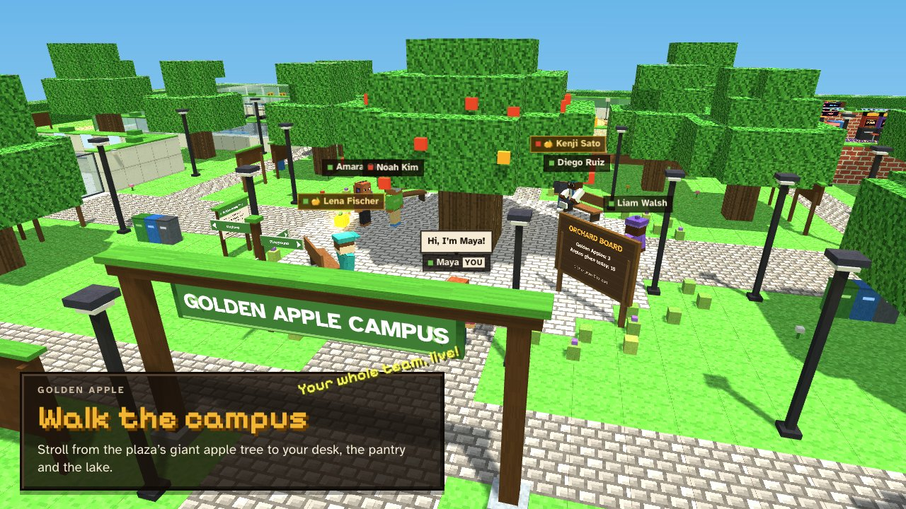

## About the game

Golden Apple turns workplace recognition into a little world you can walk around in. Build your pixel character, set up your own desk, and step out onto a green tech campus with a pantry, a gym, an arcade, tennis courts, an orchard and a lake.

Every day you get **10 apples** to give to coworkers for good work. Pick a reason, add a note, and watch the apple fly across the room. Collect **more than 10** and you become a **Golden Apple**, crowned with a spinning gold apple for everyone to see. The big apple tree on the plaza fills up with every apple given that day.

Bring your team in: one person opens a room, everyone else joins with a 6-letter code, link or QR code, and you share the same office live.

## Thank your team, out loud

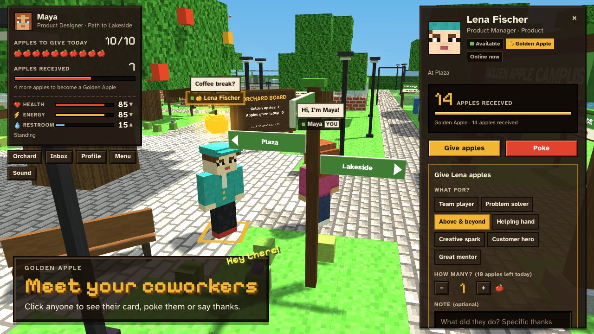

Click anyone on campus to see their card: their role, their status and how many apples they've collected. Poke them for a coffee break, or give them apples for good work.

| | |
|---|---|
| 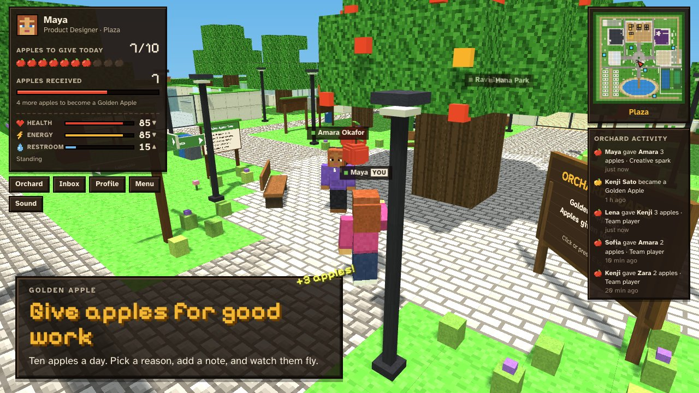 | 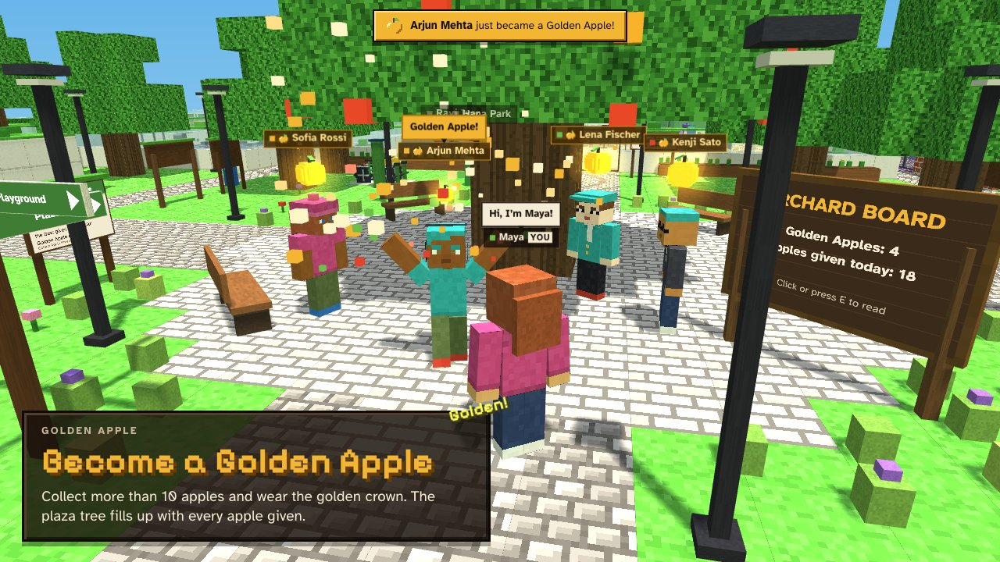 |
| **Give apples.** Ten a day. Pick a reason, add a note, and watch them fly across the plaza. | **Become a Golden Apple.** Collect more than 10 and wear the golden crown, announced to the whole office. |

## Features

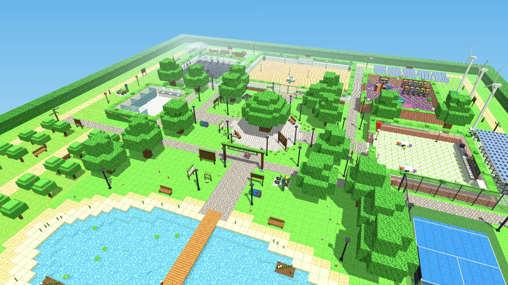

### 🌳 A whole campus to explore

Walk through the **Golden Apple Campus** arch onto a plaza with a giant apple tree, then follow the paths to:
- **Work Desks**: a bright glass office with 24 personal desks in six pods.
- **Pantry**: a cafe whose menu changes every 5 minutes.
- **Gym, Playroom and Restroom**: indoor rooms, each with its own things to do.
- **Playground**: tennis and badminton courts with stands for spectators.
- **Lake**: a dock, benches and fish to catch.

Around it all runs the **Green Loop**, a trail past a Solar Grove grazed by sheep, a Wind Row of turning turbines, a Kitchen Garden with a greenhouse and beehives, a Wildflower Meadow and a Heritage Orchard of 28 apple trees. Signposts point the way, a campus map shows where you are, and an info board at every place tells you what you can do there.

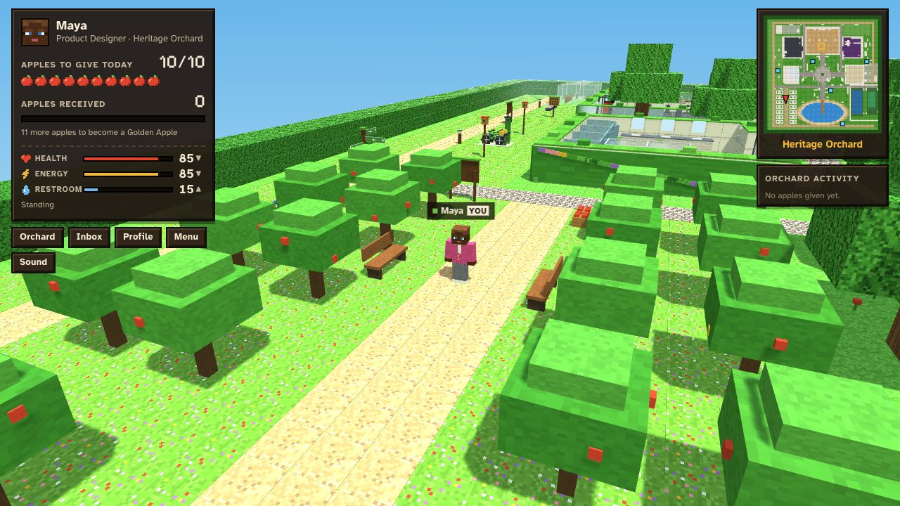

### 🎨 Make it yours
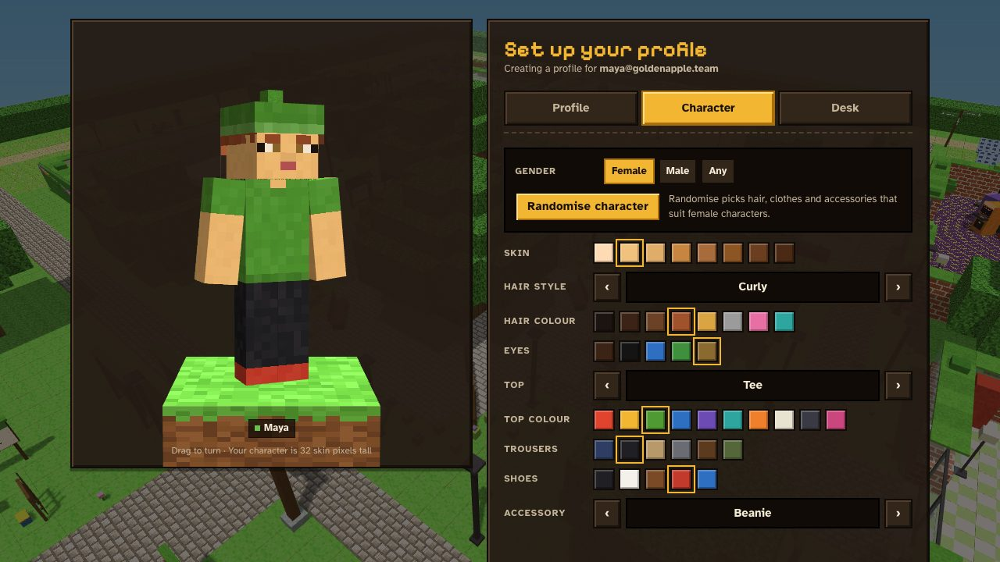

- **Character:** choose skin, hair, eyes, clothes and accessories, or pick a gender and hit **Randomise** for a fitting look.
- **Desk:** choose its colour, chair, computer, a plant, a desk pet (cat, dog, hamster, bunny, goldfish or turtle) and a couple of decor items. Your desk is yours alone: only you can sit there.

### 🚲 Campus bikes
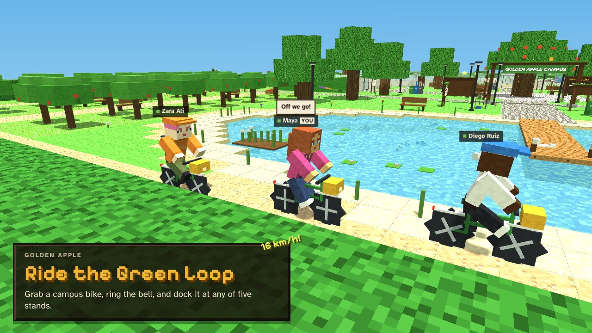

Five bike stands with two bikes each sit around the grounds. Grab one, ride the Green Loop at a real 16 km/h (25 when you pedal hard), ring the bell, and return it to any stand, or leave it on its kickstand for someone else. In a room, everyone sees who's riding which bike.

### 💼 Your own desk
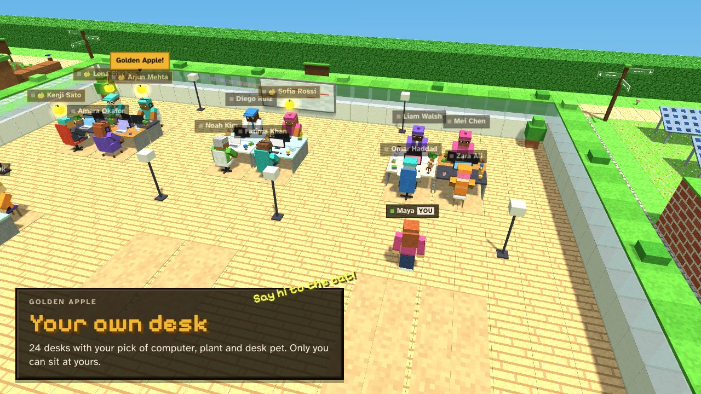

Everyone gets one of 24 desks in a bright glass office, styled their way, from two monitors and a bonsai to a goldfish bowl. Coworkers who are away sit at their desks, so you always know who's around.

### 🍜 A pantry worth visiting
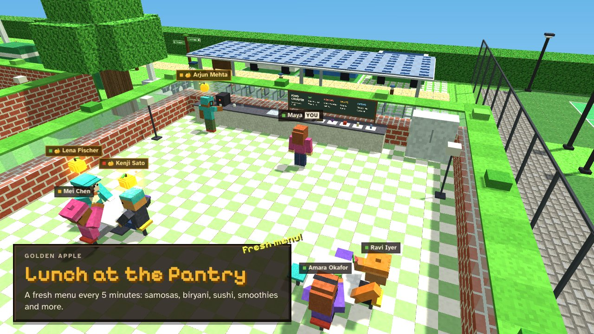

- **The menu:** eight dishes at a time, from samosa and masala dosa to chicken biryani, sushi, watermelon and mango lassi. A fresh menu arrives every 5 minutes.
- **Eating:** take a plate, sit at a cafe table and eat, with crunching, crumbs and the occasional burp.
- **Coffee:** the machine brews a cup that perks you up for a while.

### 🎮 Things to do

| | |
|---|---|
| 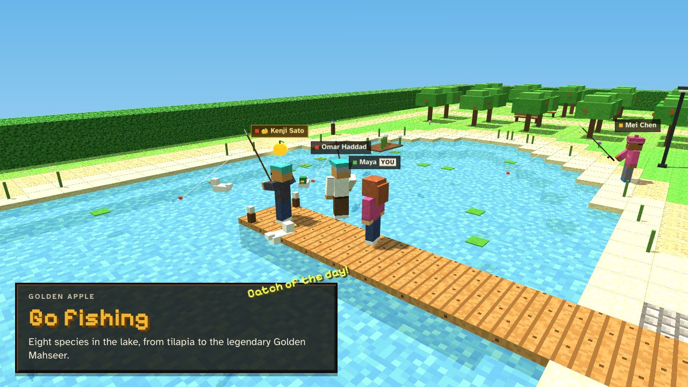 | 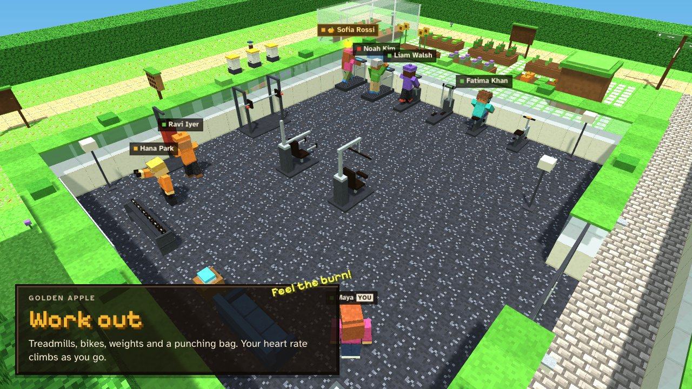 |
| 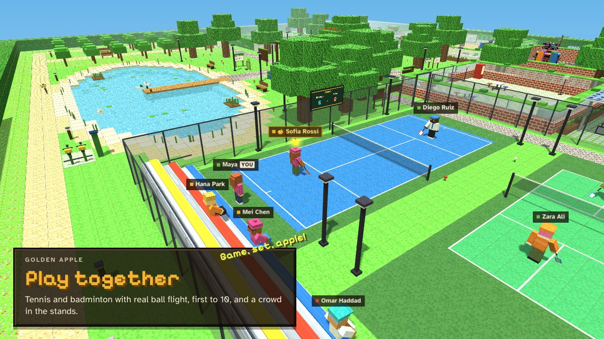 | 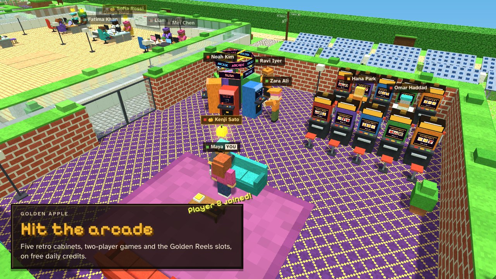 |

- **Arcade**: five retro cabinets in a ring under a spinning ARCADE sign: Paddle Duel, Snake Duel, Star Orchard, Brick Break and Apple Rush. Play alone against the computer, or have a coworker walk up and join as Player 2.
- **Golden Reels**: ten slot machines with levers and flashing lights, played with free daily credits. No real money, ever.
- **Tennis and badminton**: challenge someone in the other half of the court and play first to 10, win by 2. Real ball flight, a scoreboard and a crowd in the stands.
- **Gym**: treadmills, ellipticals, exercise bikes, a punching bag and weights. Your heart rate climbs as you work out.
- **Fishing**: eight species, from tilapia to the legendary Golden Mahseer. Cast, wait for the bite, strike, and reel without snapping the line. Keep your catch or let it go.
- **Pokes and waves**: tap a coworker to see their card, double-tap to poke them, and every poke lands in their inbox.

### 💛 Look after yourself
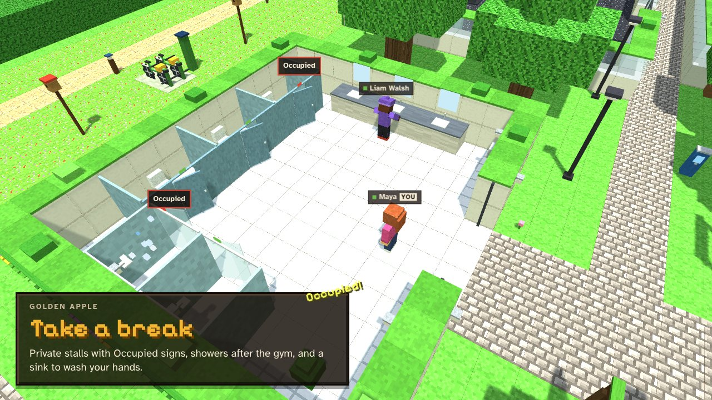

Health, energy and a restroom bar change with everything you do.
- **Food and coffee:** meals digest slowly, and coffee kicks in then wears off.
- **Rest:** a sofa or a lakeside bench brings your energy back.
- **Running low:** you yawn, slow down and can't focus at your desk.
- **The restroom:** private stalls with Occupied signs, and showers after a workout. Don't forget to wash your hands.

### 🌙 Day and night
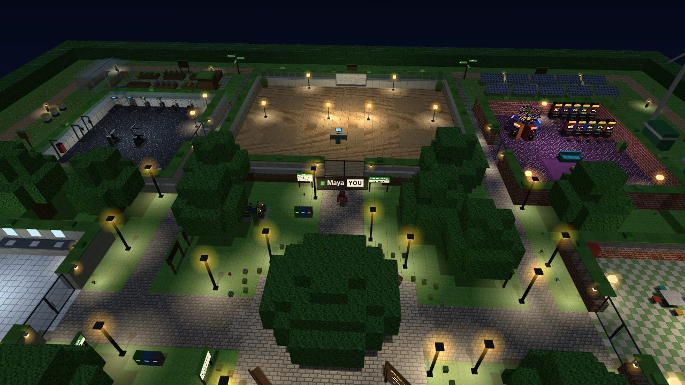

A real-time day follows the clock: half an hour of daylight, then half an hour of night. As dusk falls, 80 lamps flicker on one by one, stars come out over the campus, and crickets replace the birdsong. Every place also has its own music and ambience, all generated live in your browser.

### 🤝 Play together
- **Joining:** one person creates a room and shares the 6-letter code, the link or the QR code. Everyone on the same Wi-Fi walks into the same office.
- **What everyone sees:** each other moving, sitting, eating, working out, fishing and playing.
- **What everyone shares:** apples, pokes, the Golden Apple board and the bikes.
- **Playing together:** two-player arcade games and real tennis matches.

### 🌍 Built like the real world
- **Real sizes:** everything is built to a 1.8 m person, with chairs, tables, cars, bikes and lamps sized like the real thing.
- **Real movement:** you walk at a brisk 1.6 m/s, run at 5.6 m/s, swim and wade.
- **Real collision:** you bump into what you see, including other people.
- **Living rooms:** doors slide open as you approach.

## Controls

| | Keyboard and mouse | Phone and tablet |
|---|---|---|
| Move | **WASD** or arrows | Left thumb: a stick appears where you touch |
| Run | **Shift** | Push past the ring |
| Look around | Drag, or turn on **Mouse look** in the Menu and just move the mouse | Drag on the right side |
| Zoom | Mouse wheel | Pinch |
| Use (sit, take, play, ride, cast…) | **E** | **Use** button, which names the action |
| Jump (bell on a bike, swing in a match) | **Space** | **Jump** button |
| Eat / put down | **F** / **Q** | **Eat** / **Drop** buttons |
| See someone's card / poke | Click / double-click | Tap / double-tap |
| Mute | **M** | Menu |

On phones the game plays in landscape and the HUD starts compact: tap your panel, the map or ☰ to see more.

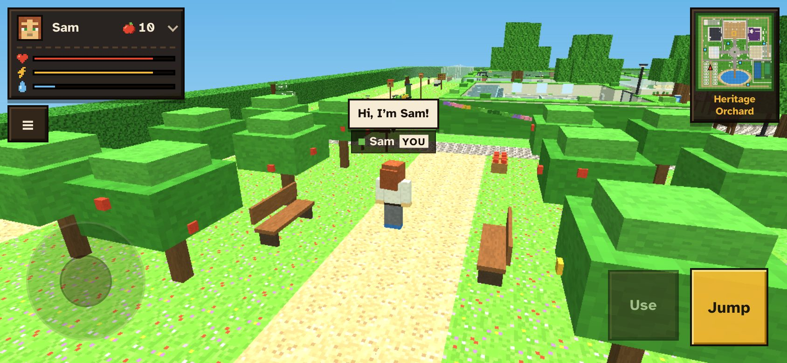

## Good to know

- **Free and runs in the browser.** Works in current Chrome, Edge, Firefox and Safari, on desktop, phones and tablets (landscape). Loading the page needs the internet.
- **Private by design.** There's no server and no password. On your own, everything stays in your browser. In a room, it lives in the host's browser. Coworkers see your name, role and team, never your email.
- **Rooms are for one office network.** Everyone needs to be on the same Wi-Fi, and the host keeps their tab open (the room pauses if it closes and picks up again when it reopens). Some guest or corporate Wi-Fi networks block devices from seeing each other.
- **Rooms of about 10–20 people** play best. There are 24 desks.
- **Made for teams you trust.** Anyone with the room code can sign in with an email, so it's built for friendly teams, not for anything secret.
